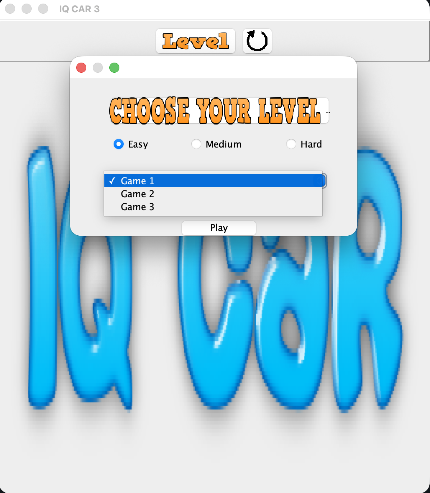
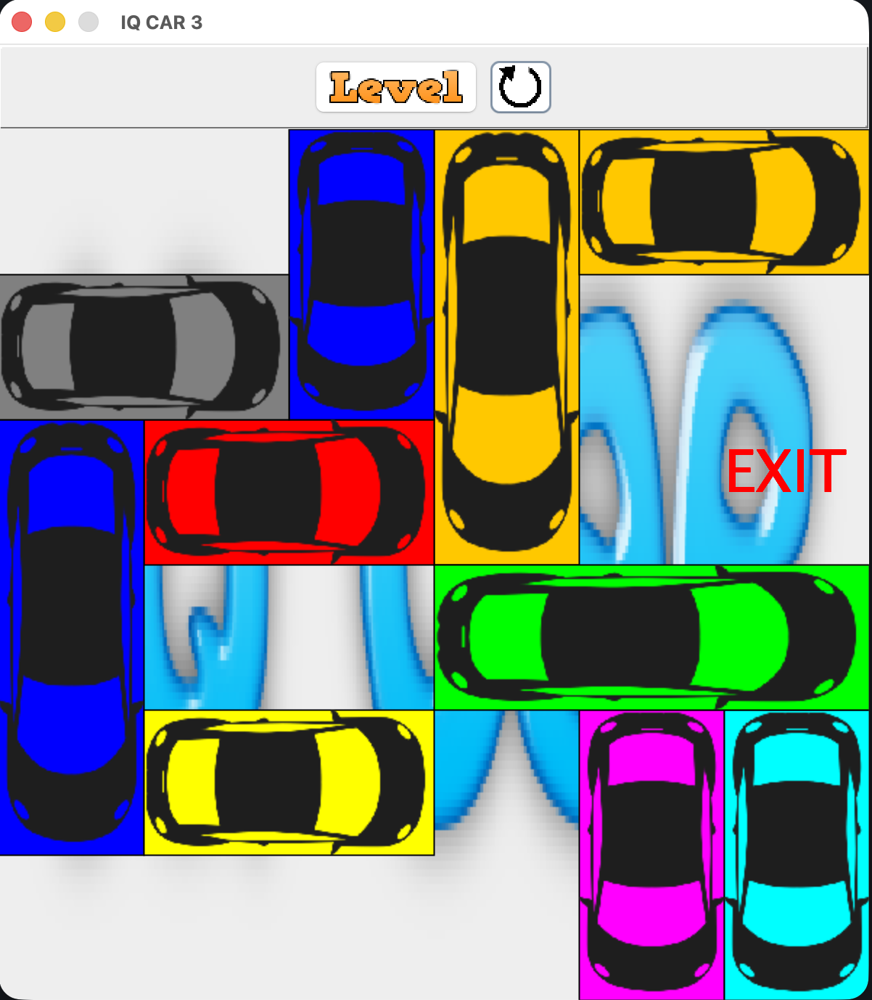

# IQ Car

A Rush Hour clone I built in Java. If you've never played Rush Hour, the idea is stupid simple and also weirdly hard: there's a red car stuck in a parking lot full of other cars, and you have to slide the other cars out of the way so the red one can escape out the right side. That's the whole game. Sounds easy. It is not.

I made this because I wanted to see if I could build a real GUI game from scratch, not follow some copy-this-code tutorial. Ended up learning way more about Swing than I ever wanted to.

## Screenshots

Pick your level and which board you want. Easy, Medium, Hard, three games each.



And here's an actual puzzle mid-solve. Red car wants out the right side where it says EXIT. Everything else is in the way.



## How to play

You get a 6x6 grid. Cars are either 2 or 3 squares long, and they only move in the direction they're pointing — a horizontal car goes left and right, a vertical car goes up and down. No turning. Cars are cars, not helicopters.

Click a car to pick it. Then use the arrow keys. If the car is horizontal, left and right arrows move it. Vertical car, up and down. You can't push through another car, so you have to actually think about the order you move things.

The red car is the one you care about. Get it to the right edge and you win — a little popup tells you so. There's a restart button up top if you jam yourself into a corner, which you will. A menu button lets you pick the game and the difficulty: Easy, Medium, Hard, three boards each.

## Compile and run

You need a JDK installed. Java 8 or newer, check with:

```
java -version
```

From the project root, compile everything into a `bin` folder:

```
javac -d bin src/com/situ/*.java
```

Then run it:

```
java -cp bin com.situ.frame
```

One thing that will trip you up. The image files are loaded by relative path — literally `src/resources/whatever.png` — so you HAVE to run from the project root. Run it from anywhere else and the cars turn into blank boxes because the sprites don't load. Took me an embarrassingly long time to figure that out the first time.

## Next steps

The levels are all hand-typed into `Board`, one `cars.add(...)` line at a time. That's fine for nine boards. It's miserable for ninety. So the obvious next move is a level file format — read boards from text or JSON instead of baking them into the code. Then adding puzzles is just editing a file, and I could even generate them.

The bigger dream is getting it on a phone. Right now it's Swing, which does not exist on Android or iOS at all, so that's not a port, it's a rewrite. Probably the game logic — the `Car` class, the movement rules, the win check — could survive and just get a new front end on top. Touch instead of click-then-arrow-key would actually feel better on a phone anyway. Drag the car with your finger. That's the whole interaction.

